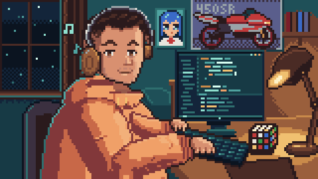
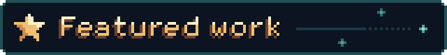
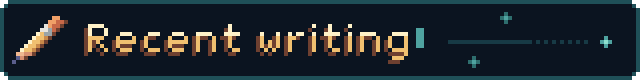
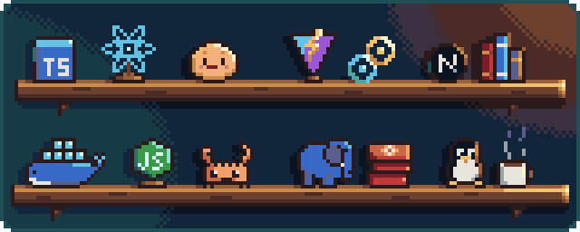
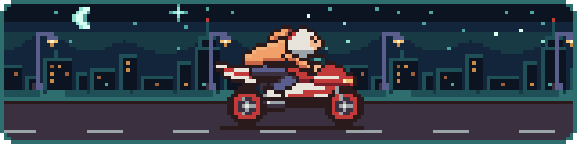

<p align="center">
  
</p>

<p align="center">
  
</p>


Full-stack developer from Poland, remote-first (CET). I build complete products in TypeScript and Rust:
desktop apps with Tauri and Electron, end-to-end typesafe web apps with tRPC, Vite and TanStack, backends on Node and NestJS.
I ship them properly: CI, tests, releases, docs, and upgrades users don't have to think about.

**Open to:** full-time remote roles · contracts & MVPs  
**Languages:** Polish (native) · English (C1)  
**Reach me:** <support@shirone.dev> · [shirone.dev](https://shirone.dev) · [shirone.blog](https://shirone.blog) · [Discord](https://discordapp.com/users/705891140049829908)

---

<p align="center">
  
</p>


**[AutoMaker](https://github.com/AutoMaker-Org/automaker)** · ⭐ 3.2k  
Autonomous AI dev studio: describe a feature on a Kanban board, a Claude agent implements it in an isolated git worktree, you review the diff. Started for fun with a team of 4 and grew into something much bigger within a month. I was the #1 contributor: agent execution pipeline, server architecture, auth, Docker/CI, and day-to-day issue triage.

<br clear="left">


**Business ERP** · in progress, private  
The project I'm putting everything I know into. A grant-funded ERP I've been building for several months on a deliberately boring, proven stack: tRPC for end-to-end type safety, Vite, the TanStack family, Prisma and PostgreSQL. Multi-tenant data model, audited writes, typed contracts from database to UI. It's also where most of my lint rules come from.

<br clear="left">


**[noctcore/eslint-plugins](https://github.com/noctcore/eslint-plugins)** · [docs](https://noctcore.github.io/eslint-plugins/) · [npm](https://www.npmjs.com/org/noctcore)  
Guardrails for codebases where AI agents write a lot of the code. 13 packages with 110+ rules: ESLint plugins plus whole-repo rules for [`@noctcore/harness`](https://github.com/noctcore/nightcore/tree/main/packages/harness), catching what generic linters can't see: Prisma tenancy and transaction fences, SSRF and path traversal, fetch timeouts, structured logging, untrusted LLM output. Rules are promoted into a package only after they've caught something real, and every example in the docs runs in the test suite.

<br clear="left">

```
pnpm add -D @noctcore/eslint-plugin-security @noctcore/eslint-plugin-async-safety @noctcore/eslint-plugin-prisma
```


**[Shiranami](https://github.com/Shironex/shiranami)** · [shiranami.app](https://shiranami.app)  
Local-first music player for the files you already own. v2 is a ground-up rewrite from Electron to Rust + Tauri, shipped without stranding a single user's library: Windows installer 110 MB → 12.5 MB, idle RAM ~688 MB → ~291 MB, 189 ms cold boot, 1,500+ Rust tests. [How the rewrite went →](https://shirone.blog/blog/shiranami-v2-rust-rewrite/)

<br clear="left">


**[Omniscribe](https://github.com/Shironex/omniscribe)**  
Runs up to 12 parallel AI coding sessions in one window, each with its own PTY terminal, git worktree, and MCP config. My daily driver.

<br clear="left">


**[ShiroAni](https://github.com/Shironex/shiroani)** · [shiroani.app](https://shiroani.app)  
Anime browser and tracker with a native C++ overlay.

<br clear="left">


**[shirone.dev](https://shirone.dev)** · [source](https://github.com/Shironex/portfolio)  
My portfolio as a desktop OS in the browser: draggable windows, ⌘K command palette, focus traps, reduced-motion support, noscript fallback. Next.js 16 + Tailwind v4.

<br clear="left">

---

<p align="center">
  <a href="https://shirone.blog"></a>
</p>


- [Swapping the Engine Mid-Flight: Shiranami 2 and a 186k-Line Merge](https://shirone.blog/blog/shiranami-v2-rust-rewrite/)
- [Green Is Not Evidence: How I Keep AI-Written Code Honest](https://shirone.blog/blog/green-is-not-evidence/)
- [Taming 12 Terminals: How I Stopped the UI from Freezing](https://shirone.blog/blog/terminal-performance-at-scale/)
- [The asar Trap: When Your AI Agent Works in Dev but Dies in Production](https://shirone.blog/blog/electron-asar-trap/)

Field notes from building desktop apps and AI dev tooling: decisions, mistakes, and lessons learned in production. No tutorials.

<br clear="right">

---

<p align="center">
  
</p>

<p align="center">
  
</p>

**Also:** NestJS · Electron · Prisma · tRPC · TanStack libraries · Drizzle · SQLite · Vitest · Playwright

**Infrastructure:** self-hosting my own servers for 2+ years (Coolify across Hetzner and OVH, Cloudflare Tunnels, Tailscale, S3-compatible storage, DNS and mail). Previously AWS and Terraform.

<p align="center">
  
</p>
